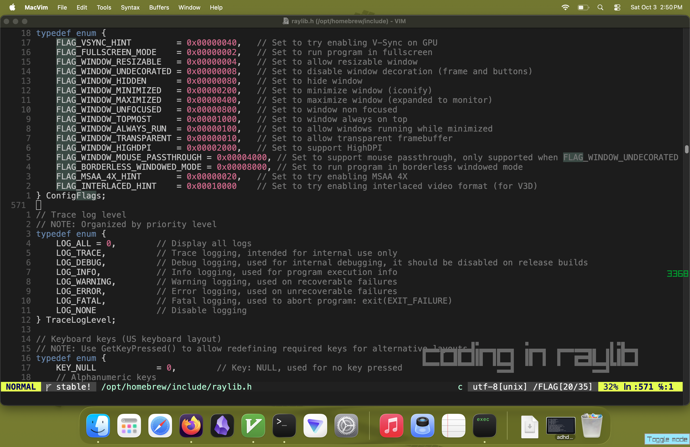
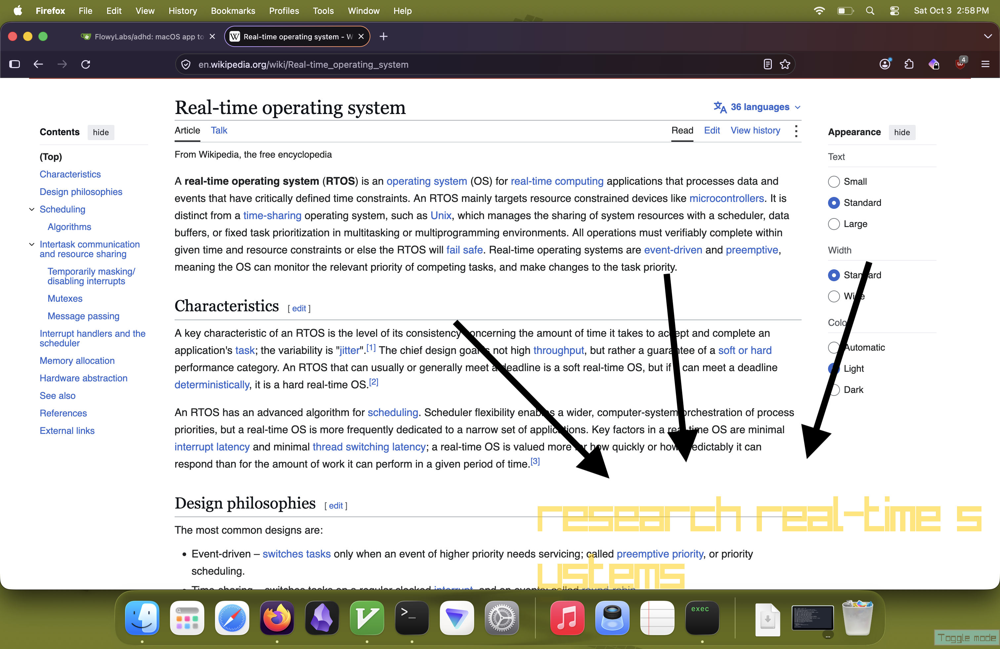

# Flowy.adhd

We live in a noisy digital world. Unless you turn off your WiFi, millions of companies bid for your attention as you try to perform even the simplest of tasks.

This tool is a free, open-source application to help you stay on track. You set an intention before you work, and an overlay will remind you of your intention every x minutes.





## Install
At the moment, you must build and install the application yourself. There are minimum dependencies, so you essentially just need a C compiler.

### macOS
```sh
brew install raylib
git clone https://git.talksik.com/FlowyLabs/adhd
cd adhd
make
./adhd

# Optional
sudo make install
```

### Linux
```sh
# Install raylib according to your distro

git clone https://git.talksik.com/FlowyLabs/adhd
cd adhd
make
./adhd

# Optional
sudo make install
```


## How it works

1. Set your intention when you sit down at your computer
2. A persistent overlay reminds you of your intention
3. Set whether today was a win (focused) or loss (distracted), and view your daily activity in a nice graph

## Philosophy

In a world of fancy todo managers, for anyone with adhd, doing one thing at a time is the key. Win one intention at a time instead of planning, prioritizing, and juggling 100s of things.

## Features

- **No sign in required**
- **Slick overlay to show current intention**
- **Lightweight** - Written in C with few dependencies, nothing bloated like electron
- **Privacy first** - No telemetry, works offline
- **Session history** - Review your past wins and losses
