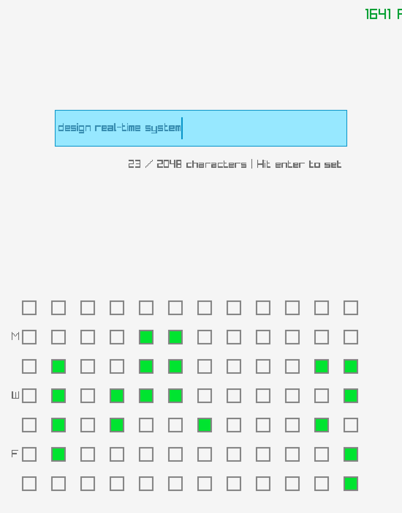

# Flowy.adhd

We live in a noisy digital world. For anyone with adhd, doing one thing at a time is the key. NOT using fancy todo managers. Win one intention at a time instead of planning, prioritizing, and juggling 100s of things.

This tool is a free, open-source application to help you stay on track. You set an intention before you work, and a big, fat overlay stays in your periphery to keep you on track.




## Install
At the moment, you must build the application yourself.

Dependencies:
- raylib
- sqlite3

### macOS
```sh
brew install raylib
git clone https://git.talksik.com/FlowyLabs/adhd
cd adhd
make
./adhd

# Optional
sudo make install
```

### Linux
```sh
# Install raylib, sqlite3 according to your distro

git clone https://git.talksik.com/FlowyLabs/adhd
cd adhd
make
./adhd

# Optional
sudo make install
```

## How it works

1. Set your intention when you sit down at your computer
2. A persistent overlay reminds you of your intention
3. Set whether today was a win (focused) or loss (distracted), and view your daily activity in a nice graph

## Features

- **No sign in required**
- **Slick overlay to show current intention**
- **Lightweight** - Written in C with few dependencies
- **Privacy first** - No telemetry, works offline
- **Daily history** - Keep track of which days you won or lost
